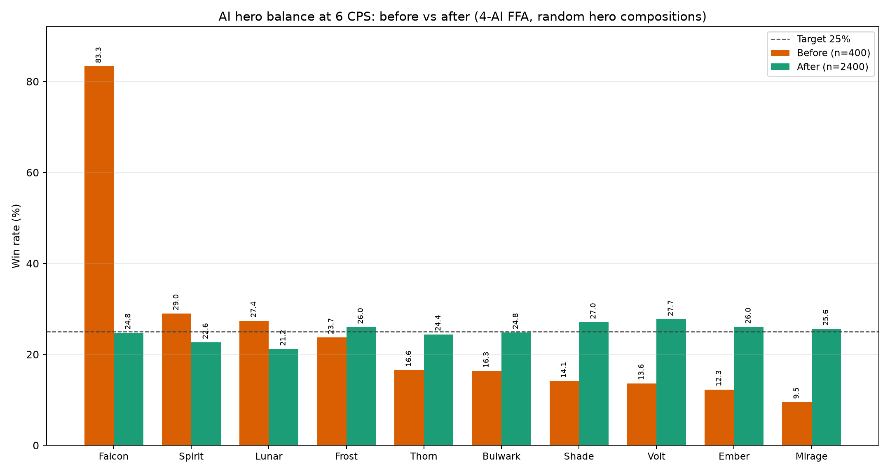

# AI 胜率平衡报告（6 CPS 标准）

## 结论

在 **4 AI 自由混战、统一 6 CPS、噩梦决策档** 下，把每个 AI 英雄作为“初始英雄”统计胜率：

- 调整前：**9.5% – 83.3%**，标准差 **20.5 个百分点**，苍隼一家独大。
- 调整后：**21.2% – 27.7%**，标准差 **1.86 个百分点**，最大偏离 25% 仅 **3.84 个百分点**。
- 2400 场验证中，10 个英雄的平均胜率为 **25.0%**，已经回到 4 人局的理论均值。



## 最终数据

样本：4 个独立种子段 × 600 场 = **2400 场** 4 AI 混战。每局从 10 个英雄中随机抽 4 个（不重复），统计“初始英雄”的胜率。

| 英雄 | 调整前 | 调整后 | 调整后样本 | 95% CI |
| --- | ---: | ---: | ---: | --- |
| 苍隼 falcon | 83.3% | **24.8%** | 249/1006 | ±2.7 |
| 灵姝 spirit | 29.0% | **22.6%** | 216/955 | ±2.7 |
| 月弦 lunar | 27.4% | **21.2%** | 204/964 | ±2.6 |
| 霜翎 frost | 23.7% | **26.0%** | 228/878 | ±2.9 |
| 荆棘 thorn | 16.6% | **24.4%** | 236/967 | ±2.7 |
| 磐卫 bulwark | 16.3% | **24.8%** | 237/955 | ±2.7 |
| 影刺 shade | 14.1% | **27.0%** | 268/991 | ±2.8 |
| 雷铸 volt | 13.6% | **27.7%** | 258/932 | ±2.9 |
| 炎锋 ember | 12.3% | **26.0%** | 254/976 | ±2.8 |
| 镜影 mirage | 9.5% | **25.6%** | 250/976 | ±2.7 |

> 调整前样本为 400 场，调整后为 2400 场；两者使用不同随机种子段，因此“调整前”是基线参考，不是逐局对照。

## 改了什么

### 1. 统一 6 CPS 标准

`shared/heroes.js`：

```js
nightmare: {
  // ...
  cps: 6,          // 原为 7
  clickDamage: 0.55,
  startGoldBonus: 250,
}
```

噩梦 AI 的等效点击从 7 CPS 调整为 **6 CPS**，作为本次平衡的标准。

### 2. 新增 AI 专属英雄平衡表

`shared/heroes.js` 新增 `AI_HERO_TUNING`。它只影响 **AI 控制的英雄**，不改变玩家使用同一英雄时的数值。

| 英雄 | clickDamage | startGold | thinkScale | spendScale |
| --- | ---: | ---: | ---: | ---: |
| 苍隼 falcon | 0.39 | -30 | 1.15 | 1.15 |
| 霜翎 frost | 0.60 | +35 | — | — |
| 灵姝 spirit | 0.59 | +20 | — | — |
| 月弦 lunar | 0.61 | +35 | — | — |
| 影刺 shade | 0.73 | +85 | 0.90 | 0.90 |
| 炎锋 ember | 0.79 | +95 | — | — |
| 雷铸 volt | 0.78 | +125 | — | — |
| 荆棘 thorn | 0.71 | +85 | — | — |
| 磐卫 bulwark | 0.70 | +30 | — | — |
| 镜影 mirage | 0.78 | +115 | — | — |

- `clickDamage` 越低，AI 手动点击越弱；
- `startGold` 是额外开局金币（可负）；
- `thinkScale` / `spendScale` 是 AI 决策/花钱间隔倍率，>1 更慢、<1 更快；
- 这些字段只覆盖 AI 配置，英雄基础属性、玩家操作数值完全不变。

### 3. 引擎支持“每个 AI 独立配置”

`shared/engine.js` 的改动：

- `createBattle()` 为每个 AI 生成独立 `aiCfg`，写入 `sim.ai[player.id].cfg`；
- AI 决策间隔、花钱间隔、CPS、点击伤害、开局金币都从该玩家的 `cfg` 读取；
- 旧存档/旧房间没有 `cfg` 时自动回退到 `AI_LEVELS[sim.aiLevel]`，保持兼容；
- 只在 6 CPS 档（噩梦）启用英雄专属平衡表，低难度 AI 保持原手感。

### 4. 新增平衡测试工具

`scripts/ai-balance.mjs`：

```bash
# 用当前 AI_HERO_TUNING 跑 600 场 4 AI 混战
node scripts/ai-balance.mjs --matches 600 --seed 600001

# 临时覆盖某个英雄的平衡参数做实验
node scripts/ai-balance.mjs --matches 400 --seed 500001 \
  --tuning '{"falcon":{"clickDamage":0.39,"startGold":-30}}'
```

输出每个英雄的胜率、样本量、席位胜率、平均时长和标准差。

## 为什么只调 AI 数据

没有改这些：

- 英雄基础生命/攻击/护甲/射程/攻速；
- 玩家手动点击伤害、0.065 秒间隔；
- 塔、经济、资源点、技能数值；
- 玩家和 AI 共用的战斗公式。

只调了 AI 的“执行参数”和“开局经济”。这样玩家玩苍隼仍然是原来的苍隼，只有 AI 用苍隼时会被平衡表约束。

## 复现

```bash
# 1) 语法/冒烟
npm run smoke

# 2) 平衡验证（4 个种子段各 600 场）
node scripts/ai-balance.mjs --matches 600 --seed 600001 --out data/bot-results/ai_final_s600.json
node scripts/ai-balance.mjs --matches 600 --seed 700001 --out data/bot-results/ai_final_s700.json
node scripts/ai-balance.mjs --matches 600 --seed 800001 --out data/bot-results/ai_final_s800.json
node scripts/ai-balance.mjs --matches 600 --seed 900001 --out data/bot-results/ai_final_s900.json

# 3) 生成前后对比图
python3 scripts/plot_ai_balance.py
```

## 注意

- **6 CPS / 噩梦** 使用完整平衡表；**4 CPS / 困难** 按基础点击伤害与金币缩放使用同一张表；休闲/标准保持原参数。
- 本次 2400 场验证是 **6 CPS 噩梦标准**；困难 4 CPS 使用缩放版平衡，未单独做 2400 场验证。
- 在「观战 AI」里选择「噩梦」可查看完整平衡后的 6 CPS 对局。

- 这是 **AI 对 AI** 的平衡，不代表人类对局中每个英雄的强度。
- 6 CPS 下仍有约 ±3 个百分点的残差；部分来自地图/出生点/随机阵容，部分来自 AI 决策的混沌性。
- 如果希望低难度也按 6 CPS 标准平衡，可以去掉 `engine.js` 里的 `cps >= 6` 门槛，或为每个难度单独维护一份 `AI_HERO_TUNING`。
- 如果后续改英雄基础数值，需要重新跑 `scripts/ai-balance.mjs` 复验。
