# 塔魂：四境争锋

> 无领地建塔，多英雄小队，点击即攻击。2–4 人实时混战 + AI 陪玩。

**作者：DeepSeek**

《塔魂：四境争锋》是一个零前端依赖、服务器权威的浏览器实时对战游戏。没有领地限制：你可以在任意可建造地块建塔。每座魂塔绑定一位英雄，塔数与同一英雄的个数都不设上限；点击地图上的英雄或右侧头像切换操作对象，点击敌人立即触发一次手动攻击，保留自动攻击，高 CPS 额外输出更高。自己的英雄小队全灭后，你可以继续观战，或主动重进一局新的游戏。

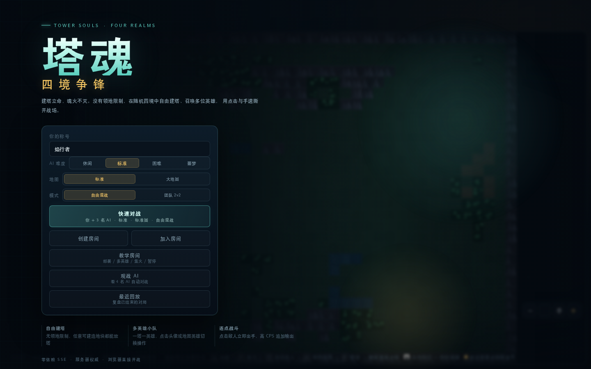

## 快速开始

需要 Node.js 18+，**无需安装任何 npm 依赖**。

```bash
npm start
```

本地打开 **http://127.0.0.1:4317**。

公共在线节点已下线；请使用本地运行或离线版。

网页离线版：**[塔魂离线版.html](塔魂离线版.html)**（无需 Node / 网络，双击即玩）

详细游玩文档：**[PLAY_GUIDE.md](PLAY_GUIDE.md)**

PDF 教程：**[塔魂游玩指南.pdf](塔魂游玩指南.pdf)**

英雄/魂塔数据表：**[英雄与魂塔数据表.pdf](英雄与魂塔数据表.pdf)**

国内部署方案与 Nginx/Caddy/Docker 配置见 **[deploy/README.md](deploy/README.md)**。

换端口：

```bash
PORT=8080 npm start
```

冒烟测试：

```bash
npm run smoke
```

## 网页离线版

- 文件：**[塔魂离线版.html](塔魂离线版.html)**
- 在线版入口已下线；请直接使用仓库中的离线文件，或本地运行 `npm start`。
- 单文件，HTML/CSS/JS/字体全部内联，不需要 Node、服务器或网络。
- 支持：单人 + 3 AI、全部英雄、手机操作、暂停、保持距离、资源加速、10:00 死亡模式、退出与 AI 难度选择。
- 不支持：多人房间、观战、回放、服务器重启重连；刷新页面会重新开始。
- 重新构建：`npm run build:offline`

## 模式

| 模式 | 说明 |
| --- | --- |
| 教学房间 | 单人 + 被动训练木桩，8 步引导，不结束对局 |
| 快速对战 | 你 + 3 名 AI，立即进入魂塔部署 |
| 创建房间 | 2–4 个席位，邀请好友加入；空位开战时由 AI 补足 |
| 加入房间 | 输入 4 位房间号加入大厅 |
| 掉线托管 | 战斗中掉线后 AI 接管你的英雄小队；刷新页面可重连 |
| 重启恢复 | 服务器每 2 秒保存房间快照，进程重启后自动恢复上一局并重连 |
| 中途暂停 | 单人 vs AI 时可按 P 暂停，AI 行动与对局计时冻结 |
| 阵亡选择 | 被淘汰后可以继续观战，或点击「重进新局」创建新的单人局；不会自动打断对局 |

## 操作

| 输入 | 行为 |
| --- | --- |
| 左键点击地面 | 当前选中英雄移动 |
| 左键点击己方英雄 / 头像 | 切换当前操作英雄 |
| 左键点击己方空魂塔 | 打开英雄祭坛（10 名英雄） |
| 左键点击敌人 | 立即尝试一次手动攻击，并让英雄继续追击 |
| `Q` / 技能按钮 | 当前英雄朝鼠标位置释放技能 |
| `F` / `Shift`+点击敌人 | 集火：所有存活英雄一起追击并攻击该目标 |
| `K` / 「保持距离」 | 当前英雄攻击时自动后撤，尽量停在最大射程边缘 |
| 右上角「退」 | 退出当前对局并回到首页（战斗中由 AI 托管） |
| `P` | 暂停 / 继续（仅单人 vs AI 对局） |
| 触屏：点地面 / 敌人 / 己方英雄 | 移动 / 攻击 / 切换当前英雄 |
| 触屏：左侧摇杆 | 拖动移动当前英雄 |
| 触屏：按住「攻」 | 自动锁定最近敌人并连续攻击 |
| 触屏：集火按钮 → 点敌人 | 全队集火 |
| 触屏：「距」按钮 | 切换当前英雄的保持距离 |
| 触屏：技能按钮 → 点地图 | 需要落点的技能（霜翎、影刺）；其他技能直接释放 |
| 右侧按钮 | 召唤英雄、新建魂塔、升级、修复、购买装备 |
| `?` / `H` | 玩法说明 |
| `Esc` | 关闭祭坛 / 取消建塔模式 |

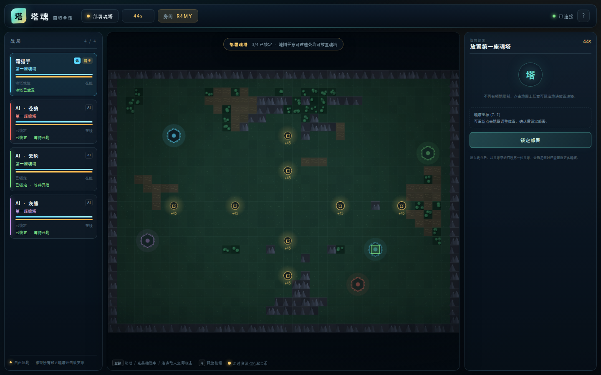

## 教学房间

开始界面的「教学房间」会创建一场单人教学对局：你加一个不会还手的「训练木桩」，额外获得 400 金币，并弹出 8 步新手指引：

1. 部署第一座魂塔
2. 锁定部署
3. 召唤初始英雄
4. 移动与切换英雄
5. 建造第二座魂塔（可重复选同一英雄）
6. 全队集火训练木桩
7. 释放技能
8. 暂停与继续

教学房间不会因为击杀木桩而结束，也没有对局计时压力。可以随时「跳过教学」继续在当前房间练习，或「退出教学」回到首页。

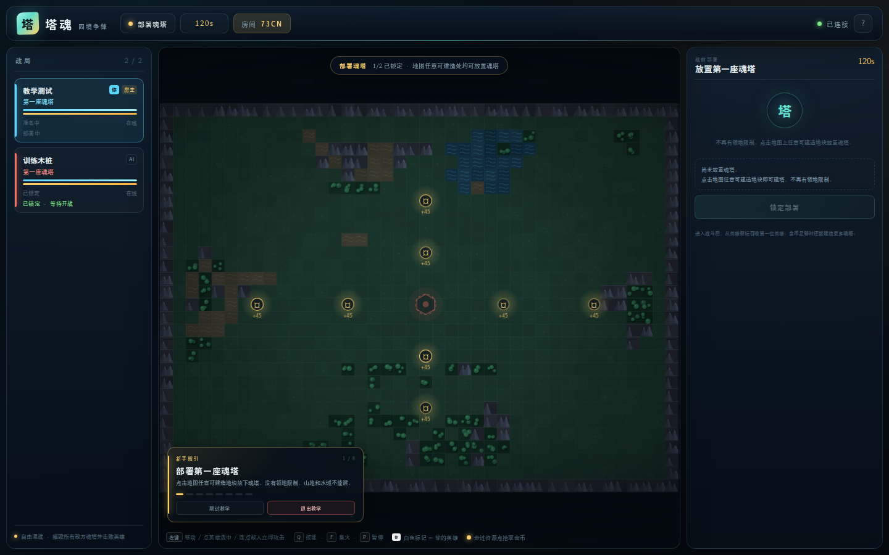

## 核心规则

- **无领地建塔**：地图任何可建造地块都能放塔，只排除山地、水域、资源点和其他魂塔。第一座魂塔免费。
- **多英雄小队**：战斗中从英雄祭坛召唤第一位英雄。金币足够后可继续建魂塔，**不设数量上限**；每座塔绑定一位英雄，同一英雄可以重复召唤且没有个数上限。
- **点击即攻击**：每次点击敌人会立即结算一次 55% 伤害的手动攻击（0.065 秒上限），同时保留原本的自动攻击。手速越快，额外输出越高。
- **集火**：按 `F` 或按住 `Shift` 点击敌人，所有存活英雄会立刻锁定同一目标并追击。
- **保持距离**：按 `K` 或点「保持距离」后，当前英雄攻击目标时会自动后撤，尽量停在射程边缘；再次按 K 关闭。远程英雄收益最大，近战也可以用来拉扯。
- **分身与召唤**：镜影的镜像和灵姝的灵仆是可被攻击的临时单位，不计入英雄数量与淘汰条件；镜像完全服从玩家，点击地面/敌人会让本体与镜像同步移动/攻击，不会自主索敌，同一英雄限 1 个；灵仆最多同时 12 只，召唤者死亡或到期后消失。
- **中途暂停**：单人 vs AI 可按 `P` 暂停；AI、弹道与对局计时全部冻结，继续后恢复。
- **手机 / 平板**：直接触屏。点地面移动，点敌人攻击，点己方英雄切换；集火和技能按钮都可直接点。需要落点的技能先点技能按钮，再点地图。建议横屏，战场视野更大。
- **英雄选择**：点击右侧英雄头像或地图上的己方英雄即可切换。己方英雄头顶有白色「你」标记，右侧「你的英雄小队」只列出自己的英雄；敌方英雄没有白色标记。移动、技能和手动攻击只作用于当前英雄，其他英雄自动攻击射程内目标。
- **魂塔与重生**：每座魂塔独立提供产金、耐久、护甲与装备。塔在，绑定英雄死亡后会重生；塔毁后该英雄无法重生并获得背水一战。所有塔被毁且所有英雄阵亡才会被淘汰。
- **金币经济**：每个英雄和魂塔都持续产金；8 个固定资源点刷新金币，英雄走过即可拾取；资源刷新间隔会随比赛时间从 16 秒逐步缩短到 6 秒；击杀英雄或魂塔获得对方该单位累计产出的 50% 赏金。
- **死亡模式**：10:00 进入死亡模式（9:30 预警），所有魂塔立即崩塌且不能新建；存活英雄进入背水一战、阵亡英雄无法重生，战斗继续到只剩一方。

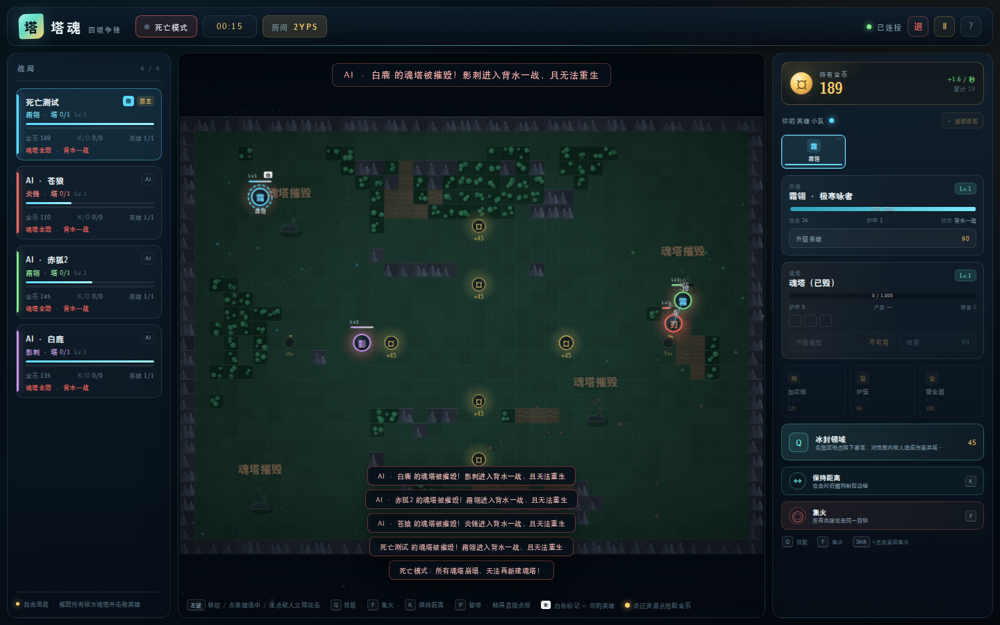
- **升级与装备**：升级当前英雄、当前魂塔，修复耐久，或安装加农炮、护壁、聚金器。
- **胜利条件**：自由混战。最后存活的小队获胜；12 分钟仍未结束时按击杀、伤害与累计产出结算。

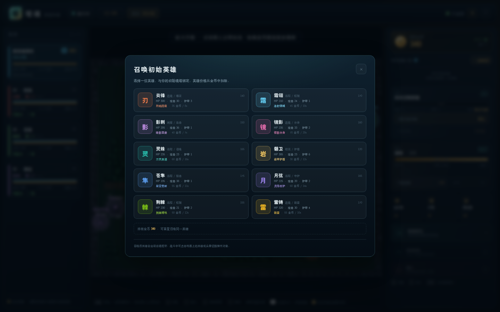

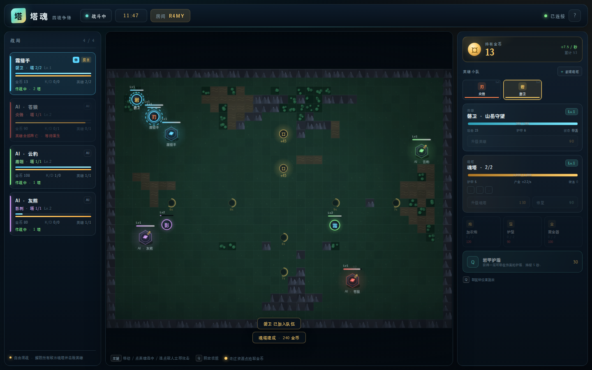

## 英雄一览

| 英雄 | 定位 | 召唤价格 | 生命 / 攻击 / 护甲 | 专属技能 |
| --- | --- | ---: | --- | --- |
| 炎锋 | 近战爆发 | 140 | 300 / 30 / 3 | 烈焰回旋：自身 AoE，35 金币 / 8 秒 |
| 霜翎 | 远程控制 | 170 | 210 / 24 / 1 | 冰封领域：指定区域伤害 + 55% 减速，45 金币 / 10 秒 |
| 影刺 | 刺客追击 | 150 | 205 / 36 / 1 | 暗影突袭：位移 + 落点伤害，40 金币 / 7 秒 |
| 磐卫 | 坦克护盾 | 120 | 385 / 23 / 6 | 岩甲护盾：吸收伤害，30 金币 / 12 秒 |
| 镜影 | 近战分身 | 160 | 235 / 33 / 2 | 镜影分身：10 秒镜像，继承 55% 生命/攻击，同一英雄限 1 个，70 金币 / 20 秒 |
| 灵姝 | 远程召唤 | 165 | 235 / 23 / 1 | 万灵奔涌：召唤 6 只 22 秒灵仆，最多同时 12 只，60 金币 / 16 秒 |
| 苍隼 | 远程狙击 | 175 | 195 / 38 / 1 | 裂空贯射：直线穿透，残血目标额外 50%，55 金币 / 11 秒 |
| 月弦 | 远程守护 | 165 | 225 / 20 / 2 | 月华庇护：范围治疗 + 护盾，60 金币 / 14 秒 |
| 荆棘 | 远程控制 | 155 | 230 / 21 / 2 | 荆棘缚地：范围伤害 + 定身 2 秒，50 金币 / 12 秒 |
| 雷铸 | 近战链雷 | 170 | 320 / 30 / 4 | 链雷：最多 4 个目标递减伤害并减速，55 金币 / 10 秒 |

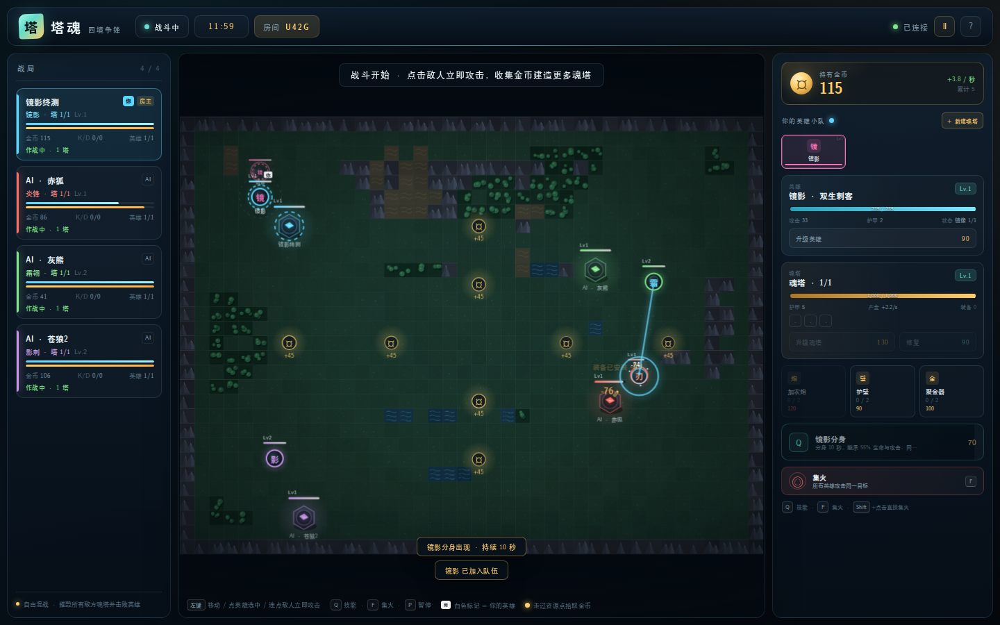

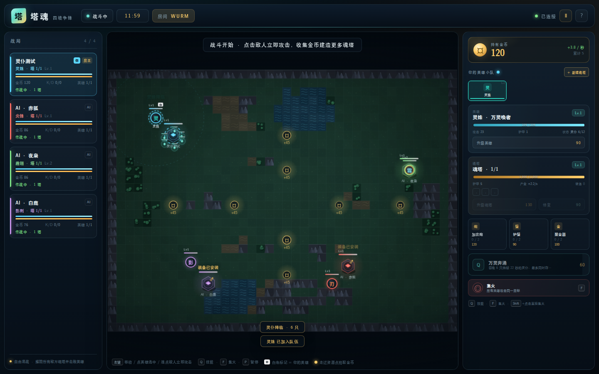

## 数值速览

- 起始金币 **340**，第一座魂塔免费。
- 初始英雄召唤费用 = 英雄价格（120–175）。
- 下一座魂塔基础建造费 = **70 + 50 × 当前已有塔数**。
  - 已有 1 座时：120 + 英雄价格
  - 已有 2 座时：170 + 英雄价格
  - 以此类推，不设塔数上限
- 英雄和塔都独立产金；英雄死亡或塔毁后该单位停止产金。
- 资源点 8 个，每次 45 金币；刷新间隔从 16 秒随比赛时间逐步缩短到 6 秒。
- 10:00 进入死亡模式：所有魂塔崩塌、不能新建，英雄无法重生。
- 英雄重生时间：`5 + 0.6 × (等级-1)` 秒。
- 12 分钟结算；被淘汰后不自动重开，可继续观战或重进新局。

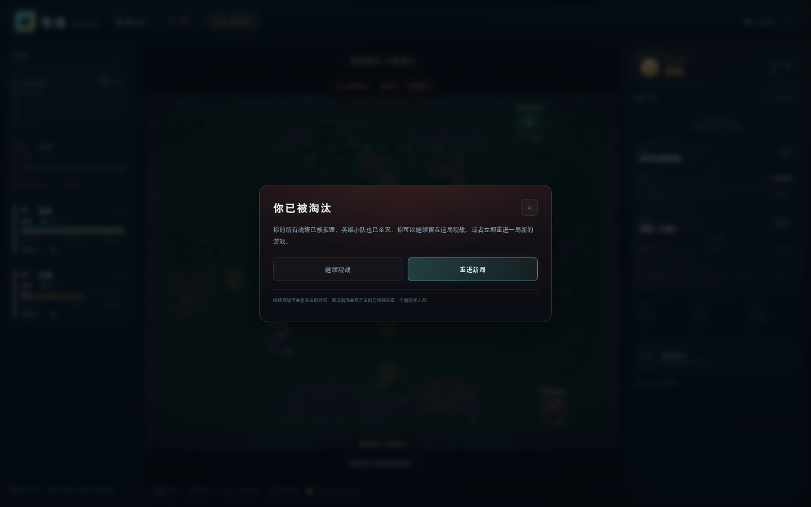

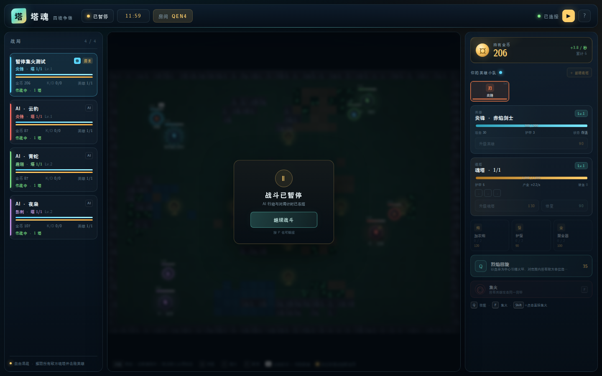

## AI 难度

快速对战开始前可选，创建房间后由房主在大厅调整：

| 等级 | 等效点击 CPS | 行为 |
| --- | ---: | --- |
| 休闲 | 1 | 反应较慢，较少集火，适合熟悉操作 |
| 标准 | 3 | 只控制当前英雄集火，其他英雄自动攻击；会扩建、升级与购买装备 |
| 困难 | 5 | 决策更快，全队释放技能，优先集火残血英雄，扩张与升级更积极 |
| 噩梦 | 7 | 全队协同集火 + 全技能释放，极快决策，持续扩塔施压 |

难度默认「标准」，选择会保存在本地；房间快照会保留该局的 AI 难度。想挑战可以选「噩梦」。

## 手机 / 平板操作

手机竖屏进入战斗后，右侧操作面板会自动收起，地图不再被挡住：

- **左侧摇杆**：拖动移动当前英雄。
- **右侧「攻」**：按住自动锁定最近敌人并连续攻击，保留高 CPS 输出。
- **「技」**：释放技能；需要落点的技能再点地图。
- **「集」**：进入集火模式，再点敌人。
- **「换」**：在多英雄之间循环切换。
- **右上角 ▤**：随时打开/收起完整的建造、升级与装备面板。
- 横屏视野更大；竖屏也能完整看到地图。

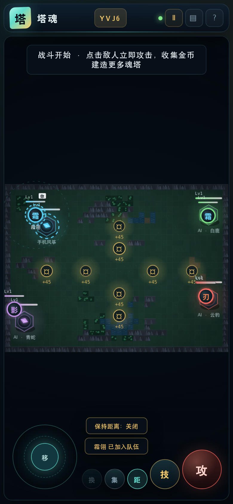

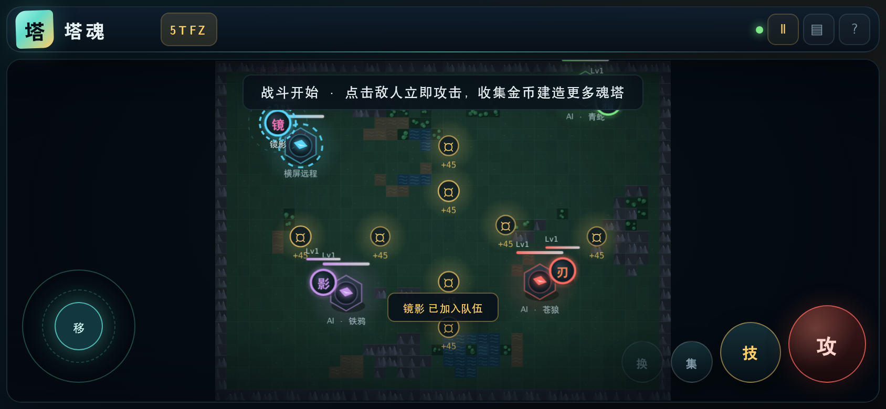

## 完全观战

开始界面新增「观战 AI」：创建一场 4 名 AI 的自动对战，你只负责看。

- 没有操作面板和英雄小队，战场占满全宽。
- 顶部显示「观战中 · AI 对战」，可随时退出。
- 观战难度沿用你选择的 AI 等级。
- 观战连接同样会保存，服务器重启后能恢复观战。

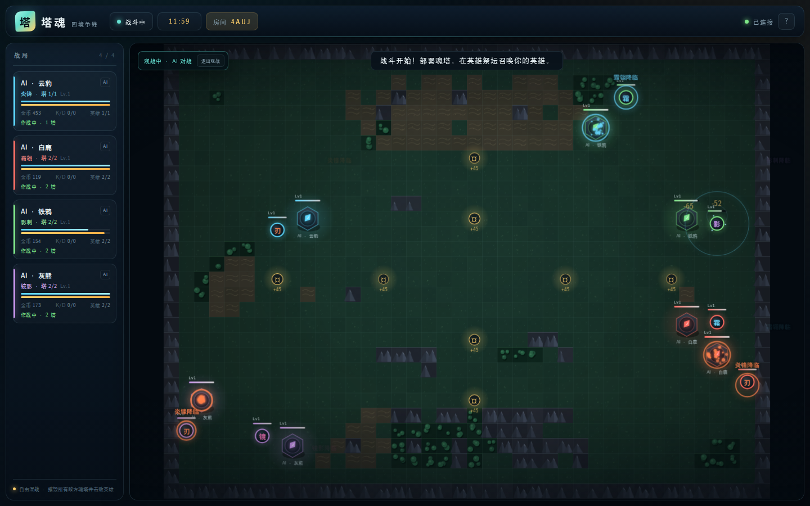

## 回放与退出

- 右上角「退」：确认后退出当前对局回首页；战斗中的席位交给 AI 托管。
- 结束界面「观看回放」：复盘刚结束的一局。
- 开始界面「最近回放」：查看服务器保留的最近 12 局回放。
- 回放以 5 FPS 记录位置并做插值，支持暂停、拖动进度、1x / 2x / 4x 倍速和退出。
- 回放覆盖英雄、魂塔、灵仆/镜像、资源点、技能特效与击杀播报；观战/回放无操作面板。

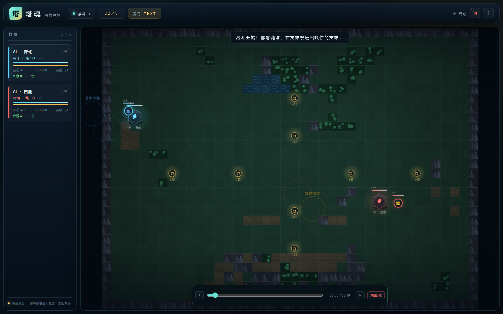

## 公共节点与自托管

- 当前不提供公共在线节点。
- 本地运行：`npm start`，打开 **http://127.0.0.1:4317**。
- 离线单文件：直接打开 `塔魂离线版.html`。
- 如需公网部署，可使用仓库中的 `deploy/`、`Dockerfile` 和 `docker-compose.yml` 自行部署。

## 服务器重启恢复

服务器每 **2 秒**把房间快照写入 `data/rooms.json`，并在 `SIGINT/SIGTERM` 退出时再保存一次。重启后：

- 已开局房间、地图、英雄、魂塔、镜像/灵仆、金币与计时都会恢复。
- 浏览器会保持当前页面并自动重连；正在战斗时会短暂由 AI 接管，重连成功后立即交还操作。
- 快照间隔意味着极端情况下可能回退约 2 秒。
- 如果快照被删除、房间已清理或进程被 `kill -9`，客户端会停止无限转圈，自动返回首页并提示「无法恢复上一局」。
- Docker 部署使用 `tower-data` 命名卷保存快照；裸机部署请确保 `data/` 对运行用户可写。

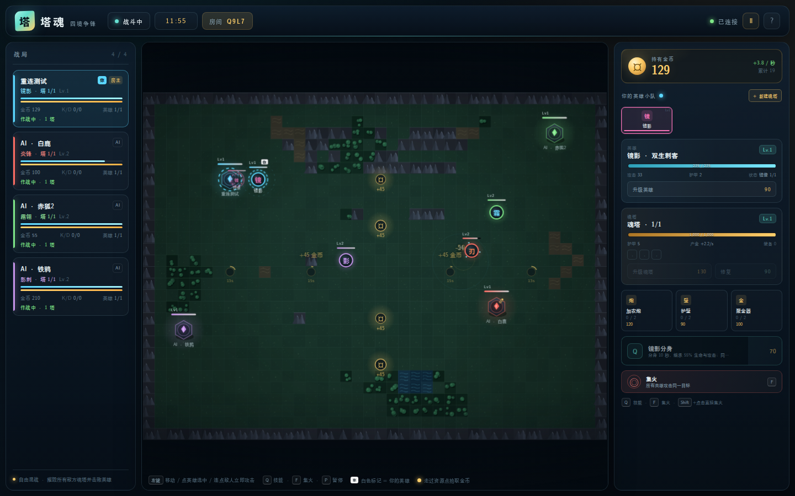

## 房间与联机

- 服务端使用 Node.js 原生 `http`，房间状态、战斗模拟与 AI 全部在服务器运行。
- 客户端通过 **SSE** 接收约 18 Hz 快照，通过 HTTP POST 提交点击/技能/升级指令。
- 每次手动点击攻击都会单独提交，因此高 CPS 会真实转化为额外伤害；服务器有 0.065 秒的最小间隔。
- 每个玩家有随机 `playerId` 作为会话令牌；刷新后使用 `sessionStorage` 恢复连接。
- 地图换局时通过 SSE `map` 事件同步新地图，避免重开后客户端仍显示旧地图。
- 战斗 30 Hz tick；服务器校验移动、建塔、金币、冷却、英雄归属、攻击距离等规则。

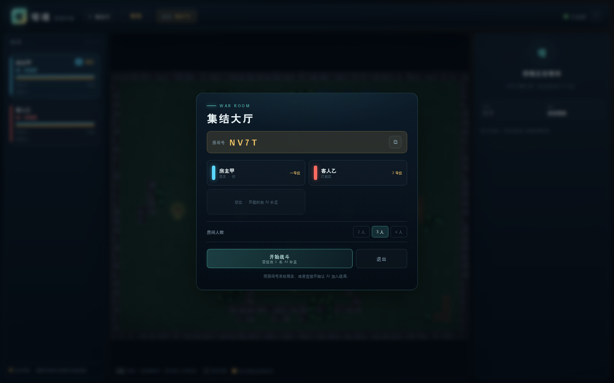

## 项目结构

```
.
├── server.js               # 零依赖 HTTP + SSE 服务器、房间、房主重开
├── shared/
│   ├── heroes.js           # 英雄、装备、经济、建造与手速数值
│   ├── mapgen.js           # 程序化地图 + A* 寻路
│   └── engine.js           # 服务器权威战斗引擎、多英雄 AI、快照
├── public/
│   ├── index.html          # 界面结构
│   ├── styles.css          # 视觉系统
│   ├── client.js           # Canvas 渲染、点击攻击、英雄切换、祭坛
│   └── fonts/              # 内置中文 Fandol 黑体（woff2）
├── data/rooms.json         # 房间快照（运行时生成；重启恢复用）
├── scripts/smoke.mjs       # 无依赖冒烟测试
├── GAME_DESIGN.md          # 完整设计文档
└── shots/                  # 游戏截图
```

## 已做验证

- 10 张随机地图的出生点、资源点连通性与自由建塔校验。
- 3 场完整 12 分钟 AI 混战的数值稳定性。
- 双客户端房间加入 / 部署 / 召唤 / 战斗同步。
- 单人多英雄：召唤、额外建塔、头像切换、手速攻击请求。
- 被淘汰后弹出「继续观战 / 重进新局」选择；观战保持当前对局，重进创建新的单人局。
- 教学房间完整 8 步流程（部署 → 召唤 → 建第二塔 → 集火 → 技能 → 暂停）自动跑通。
- 单人 vs AI 的暂停按钮可见，暂停期间 `battle.time` 冻结，继续后恢复推进。
- 集火指令会让所有存活英雄锁定同一敌方目标。
- 同一英雄可以重复召唤任意次，塔数和英雄个数均无上限。
- 镜像/灵仆数量上限、10 秒/22 秒到期回收、召唤者死亡清除均已验证。
- 镜像控制：点击地面本体与镜像同步移动，点击敌人本体与镜像同步追击/攻击；无指令时镜像原地待命。
- 保持距离：开启后射程内过近会自动后撤，目标仍在射程边缘，实测距离从 70px 拉到 161px。
- 完全观战：4 AI 自动对战、全宽战场、无操作面板。
- AI 等效 CPS：休闲/标准/困难/噩梦分别为 1 / 3 / 5 / 7，模拟当前操作英雄的额外手动点击。
- 教学房间：1 名玩家 + 被动训练木桩，8 步引导、额外 400 金币、不结束对局。
- 重启恢复：实测服务器重启后同一房间恢复、客户端自动重连，战斗时间从 3.4s 继续到 5.3s。
- AI 难度：休闲/标准/困难/噩梦可在快速对战前选择，大厅房主可调整；困难与噩梦会全队释放技能。
- 移动端：战斗自动收起右侧面板，摇杆移动、按住攻击连击、技能/集火/换人均已实测。
- 快照丢失场景：客户端检测到房间不存在后自动回到首页并提示「无法恢复上一局」，不再无限转圈。
- 房主重开时通过 `map` 事件同步新地图。
- 刷新重连、技能扣费与冷却、装备购买、终局结算与重开。

## 已知限制

- 目前是单机 / 局域网房间模式，没有公网匹配、账号系统或聊天。
- 平衡是首版基线；AI 已提供休闲/标准/困难/噩梦四档，后三档会全队集火，困难与噩梦会全队释放技能。
- 被淘汰后不会自动重开；玩家可以继续观战，或主动选择重进新局离开当前房间。
- 中途暂停只对单人 vs AI 开放；多人对局为避免影响其他玩家不提供暂停。
- 建议使用桌面端 Chromium / Firefox / Safari；移动端已提供虚拟摇杆与可折叠面板，横屏视野最佳。

完整设计见 [GAME_DESIGN.md](GAME_DESIGN.md)。
